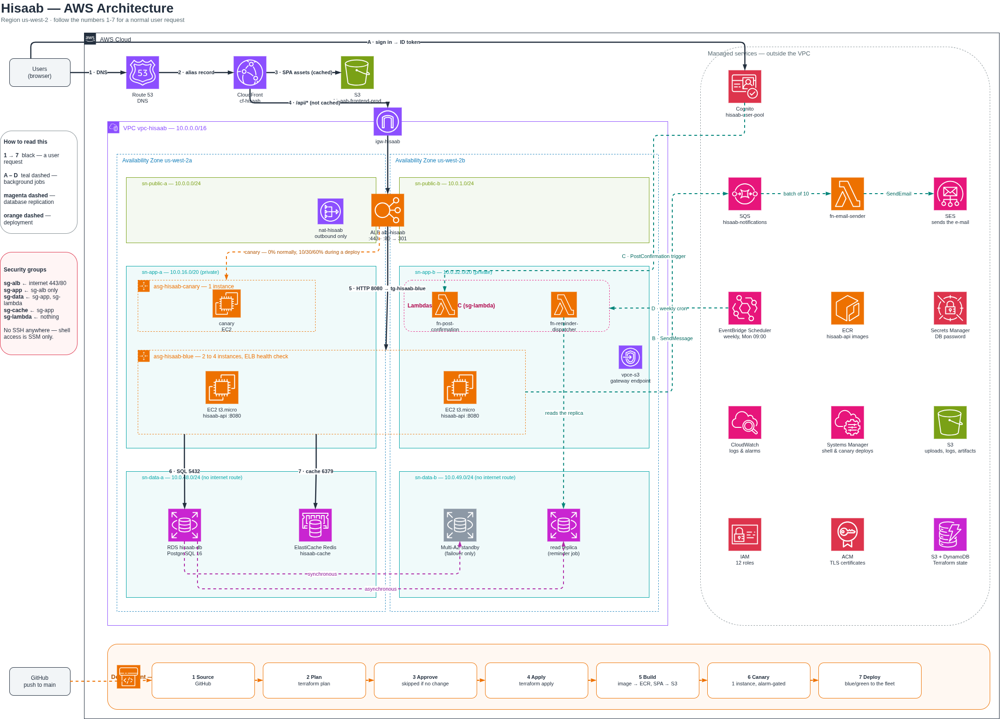

# Hisaab

Hisaab ("حساب" — Urdu for "account/reckoning") is a shared-expense tracker, Splitwise-shaped:
groups, expenses, settlements, and running balances between people. It's a full three-tier
web app on AWS with an asynchronous notification path and a CI/CD pipeline that deploys both
the application *and* its own infrastructure.



*Full diagram source (with toggleable layers — boundaries, components, request path, CI/CD,
security groups): [`docs/diagrams/hisaab-architecture-v2.drawio`](docs/diagrams/hisaab-architecture-v2.drawio)
(open in [diagrams.net](https://app.diagrams.net)).*

## What it does

- Create groups, add expenses, split them, and see who owes whom.
- Email/password auth via Cognito, verified by the API against Cognito's JWKS.
- Balance lookups are cached (Redis) and invalidated on every write.
- Weekly reminder emails for anyone with an outstanding balance.
- Every push to `main` runs through a pipeline that plans/applies infra changes, builds and
  ships the app, canary-tests the new build on live traffic, then rolls it out blue/green —
  with automatic rollback if the canary trips an alarm.

## Stack

| Layer | Tech |
|---|---|
| Frontend | React + TypeScript (Vite), served via CloudFront + S3 |
| Backend | Node/Express (TypeScript), containerized, running on EC2 behind an ALB |
| Data | PostgreSQL (RDS, Multi-AZ + async read replica), Redis (ElastiCache) |
| Auth | Amazon Cognito |
| Async | Lambda + SQS + SES + EventBridge Scheduler |
| Infra | Terraform (10 modules, 3 independent states) |
| CI/CD | CodePipeline, CodeBuild, CodeDeploy (blue/green with a scripted canary stage) |

## Repo layout

```
backend/        Express API (TypeScript)
frontend/       React SPA (TypeScript, Vite)
modules/        Terraform modules (network, security, data, cache, identity, messaging,
                compute, delivery, pipeline-infra, pipeline)
envs/prod/      The environment that wires the modules together
bootstrap/      One-time Terraform state backend (S3 + DynamoDB lock table)
github-connection/  The CodeStar Connections resource (its OAuth step is manual, by design)
docs/           Architecture deep-dive, PRD, infra spec, DB schema, diagram source
```

## Architecture deep-dive

The full as-built writeup — every module, every design decision and why, known gaps — lives
in [`docs/ARCHITECTURE.md`](docs/ARCHITECTURE.md). Highlights:

- **Nothing in the private tiers is reachable from the internet.** Only CloudFront and the
  ALB are public; the database subnets have no route to the internet at all, not even
  outbound.
- **One IAM role per workload**, scoped with resource-level ARNs rather than wildcards
  (with a handful of documented exceptions where AWS doesn't support resource scoping).
- **A canary gate in front of blue/green**: new builds get ramped to 10% → 30% → 60% of
  traffic with CloudWatch alarms watched between steps before the full fleet ever sees them.
- **Infra and app deploys are decoupled inside one pipeline**: a `terraform plan` diff gates
  a manual approval + apply; an app-only commit skips straight to build/canary/deploy.

Other docs: [`docs/hisaab-prd.md`](docs/hisaab-prd.md) (product spec),
[`docs/hisaab-infra-spec.md`](docs/hisaab-infra-spec.md) (infra spec),
[`docs/hisaab-schema.sql`](docs/hisaab-schema.sql) (DB schema),
[`docs/codedeploy-troubleshooting.md`](docs/codedeploy-troubleshooting.md) (CodeDeploy
blue/green gotchas hit along the way).

