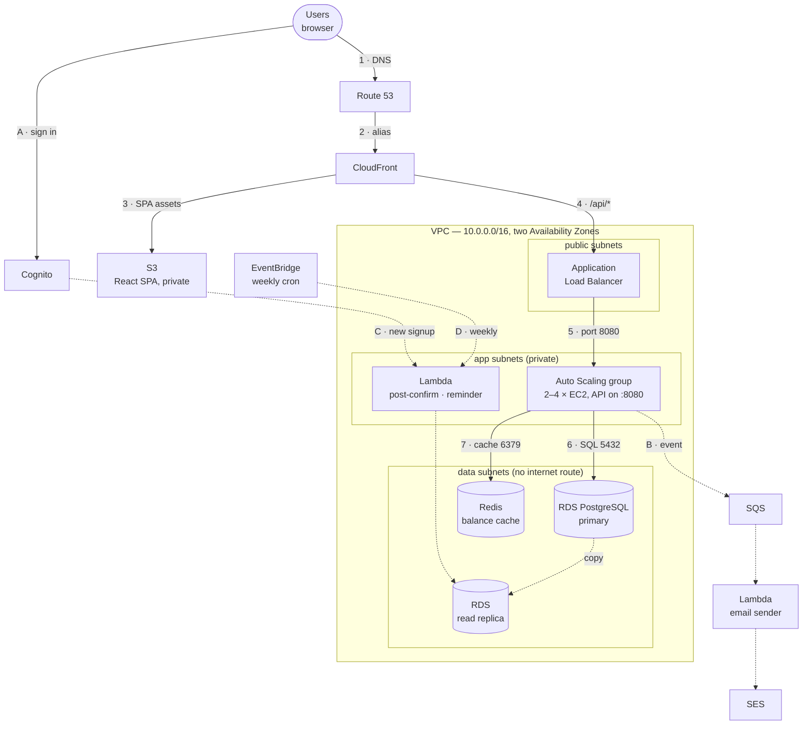

# Hisaab — AWS Architecture

**As-built description of the infrastructure defined in `modules/*` and `envs/prod`.**
Region `us-west-2`, account `<AWS_ACCOUNT_ID>`, one environment (`prod`), one VPC.

Diagram: [`docs/diagrams/hisaab-architecture-v2.drawio`](diagrams/hisaab-architecture-v2.drawio)
(open in [diagrams.net](https://app.diagrams.net) — the diagram has toggleable layers:
boundaries, components, request path, supporting flows, CI/CD, security groups).

---

## 1. What the system is

Hisaab is a shared-expense tracker (a Splitwise-shaped app). It is a three-tier web
application with an asynchronous notification side-path and a self-mutating CI/CD pipeline
that deploys both the application *and* its own infrastructure:

| Tier | What runs there | AWS services |
|---|---|---|
| Edge / static | React SPA, TLS termination, caching | Route 53, ACM, CloudFront, S3 |
| Application | Node/Express API in a Docker container | ALB, EC2 Auto Scaling, ECR |
| Data | Relational store + query cache | RDS PostgreSQL (Multi-AZ), ElastiCache Redis |
| Async | Signup hooks, e-mail fan-out, weekly reminders | Cognito, Lambda, SQS, SES, EventBridge Scheduler |
| Delivery | Build, canary, blue/green rollout, terraform | CodePipeline, CodeBuild, CodeDeploy, SSM |

### The whole system on one page

Follow **1 → 7** for a normal user request; **A → D** are background jobs.



Two design rules run through everything:

1. **Nothing in the private tiers is reachable from the internet.** The only public entry
   points are CloudFront and the ALB. Every compute and data resource sits in a private
   subnet, and the database subnets have *no route to the internet at all* — not even
   outbound through NAT.
2. **Every identity is scoped to one workload.** There are twelve IAM roles, one per
   thing that runs, each with resource-level ARNs rather than wildcards (with a handful
   of documented exceptions where AWS does not support resource scoping, such as
   `ecr:GetAuthorizationToken` and `ses:SendEmail`).

---

## 2. Terraform layout

Three independent Terraform states, on purpose:

| State | Path | Contents | Why separate |
|---|---|---|---|
| Bootstrap | `bootstrap/` | `hisaab-tfstate` S3 bucket, `hisaab-tfstate-lock` DynamoDB table, `role-terraform` | Chicken-and-egg: the backend must exist before anything else can use it. Applied by hand, once. |
| GitHub connection | `github-connection/` | The CodeStar Connections resource for GitHub | Its OAuth handshake can only be completed by a human in the console. Keeping it out of `envs/prod` means a destroy/rebuild of the environment never needs re-authorising. |
| Environment | `envs/prod/` | Everything else, via ten modules | The actual system. |

`envs/prod/main.tf` wires the modules. The dependency order is enforced by the module
graph itself:

```
network → security → data ─┬→ cache
                           ├→ identity → messaging
                           ├→ compute → delivery
                           └→ pipeline-infra → pipeline
```

A few values are passed as plain variables rather than real `module.x.output` references
(`ecr_repo_name`, `sqs_queue_name`, `post_confirmation_function_name`, …). That is
deliberate: those names are used to build **deterministic ARNs** in a module that would
otherwise create a dependency cycle. For example `modules/identity` needs the
Post-Confirmation Lambda's ARN, but `modules/messaging` already depends on `identity` for
the Cognito invoke permission — so `identity` constructs
`arn:aws:lambda:<region>:<account>:function:fn-post-confirmation` by interpolation instead
of reading the real output.

The same file also shows a **deferred-permission** pattern used repeatedly: an IAM policy
whose target ARN is generated by AWS at creation time is attached *later*, in the module
that creates the target. `modules/data` grants the DB-secret read to three roles;
`modules/compute` grants `ec2:RunInstances` on the launch template to `role-codedeploy`;
`modules/delivery` grants `cloudfront:CreateInvalidation` to `role-codebuild`;
`modules/pipeline-infra` grants `codebuild:StartBuild` to `role-codepipeline`.

---

## 3. Network (`modules/network`)

### 3.1 VPC and subnets

`vpc-hisaab`, CIDR `10.0.0.0/16`, DNS support and DNS hostnames enabled. Six subnets
across two Availability Zones, pinned **by AZ ID** rather than AZ name (AWS randomises the
name→physical-AZ mapping per account, so pinning by name is not portable):

| Subnet | CIDR | AZ | Tier | Route table | Contents |
|---|---|---|---|---|---|
| `sn-public-a` | `10.0.0.0/24` | us-west-2a | public | `rt-public` | ALB node |
| `sn-public-b` | `10.0.1.0/24` | us-west-2b | public | `rt-public` | ALB node |
| `sn-app-a` | `10.0.16.0/20` | us-west-2a | app | `rt-app` | EC2 instances, Lambda ENIs |
| `sn-app-b` | `10.0.32.0/20` | us-west-2b | app | `rt-app` | EC2 instances, Lambda ENIs |
| `sn-data-a` | `10.0.48.0/24` | us-west-2a | data | `rt-data` | RDS, ElastiCache |
| `sn-data-b` | `10.0.49.0/24` | us-west-2b | data | `rt-data` | RDS standby, read replica |

The app tier gets `/20` blocks (4 091 usable addresses each) because it holds the elastic
things: an autoscaling fleet, a temporary green fleet during every blue/green deployment,
and Lambda ENIs. Public and data tiers get `/24`s — they hold a fixed, small number of
interfaces.

### 3.2 Gateways and routing

- `igw-hisaab` — Internet Gateway, the only inbound path into the VPC.
- `nat-hisaab` — NAT Gateway in **regional availability mode** (`availability_mode = "regional"`,
  requires AWS provider ≥ 6.24). It is VPC-scoped rather than subnet-scoped: AWS
  automatically expands it into an AZ when workloads appear there and contracts when they
  leave. The operational payoff is that there is **one shared app route table** instead of
  one per AZ, so adding an AZ later needs no routing change.
- `vpce-s3` — S3 **Gateway** VPC endpoint attached to `rt-app`. S3 traffic from the app
  tier (ECR layer blobs, CodeDeploy bundles, artifacts) leaves via the AWS network rather
  than the NAT gateway; gateway endpoints are free, NAT data processing is not.

| Route table | Default route |
|---|---|
| `rt-public` | `0.0.0.0/0` → `igw-hisaab` |
| `rt-app` | `0.0.0.0/0` → `nat-hisaab`, plus the S3 gateway endpoint prefix list |
| `rt-data` | **none** — the database tier has no path to the internet in either direction |

### 3.3 Flow logs

VPC Flow Logs capture **REJECT traffic only**, delivered to the CloudWatch Logs group
`/hisaab/vpc-flow-logs` (14-day retention) via `role-vpc-flow-logs`, with a 600-second
aggregation interval. REJECT-only keeps the volume (and cost) low while still recording
exactly the thing worth alerting on: something tried to reach something it is not allowed
to reach.

### 3.4 DNS and certificates

The Route 53 hosted zone `example.com` (`Z06937211L1EVF6QE14XW`)
already exists and is already delegated — Terraform **looks it up, never creates it**, and
only writes records under the `hisaab.` prefix.

| Record | Type | Target |
|---|---|---|
| `hisaab.<domain>` | A alias | CloudFront distribution |
| `app.hisaab.<domain>` | A alias | ALB (with `evaluate_target_health`) |
| ACM validation records | CNAME | Both certificates |
| `_amazonses.hisaab.<domain>` | TXT | SES domain verification token |
| `<token>._domainkey.hisaab.<domain>` ×3 | CNAME | SES DKIM |

Two certificates, because CloudFront can only use certificates from `us-east-1`:

- `cert-alb` in **us-west-2**, covering `app.hisaab.<domain>` — used by the ALB's HTTPS listener.
- `cert-cloudfront` in **us-east-1** (via the `aws.us_east_1` provider alias), covering
  `hisaab.<domain>` — used by the distribution.

Both are DNS-validated, with the validation records written by Terraform and an explicit
`aws_acm_certificate_validation` wait so downstream resources never attach an unvalidated
certificate.

---

## 4. Edge and content delivery (`modules/delivery`)

### 4.1 Frontend bucket

`hisaab-frontend-prod` — private, SSE-S3 encrypted, all four public-access blocks on, no
S3 website endpoint. Its bucket policy allows exactly one principal:
`cloudfront.amazonaws.com`, conditioned on `AWS:SourceArn` equal to this distribution's ARN
(Origin Access Control, SigV4). A second statement denies everything over plain HTTP
(`aws:SecureTransport: false`).

### 4.2 CloudFront distribution `cf-hisaab`

One distribution, two origins, so that the SPA and the API share a single origin and no
CORS handling is needed anywhere:

| Behaviour | Path | Origin | Cache policy | Notes |
|---|---|---|---|---|
| default | everything else | S3 `hisaab-frontend-prod` via OAC | CachingOptimized | compression on, SPA-fallback function attached |
| ordered | `/api/*` | ALB `app.hisaab.<domain>`, custom origin, **https-only**, TLSv1.2 | CachingDisabled | `AllViewer` origin-request policy (forwards Host, headers, cookies, query string); all HTTP methods allowed |

Viewer settings: alias `hisaab.<domain>`, `cert-cloudfront`, SNI-only, minimum protocol
`TLSv1.2_2021`, IPv6 enabled, `redirect-to-https`, default root object `index.html`.

### 4.3 SPA fallback: a CloudFront Function, not `custom_error_response`

Client-side routing needs `/groups/abc` to serve `index.html`. The obvious mechanism —
`custom_error_response` mapping 404 → `/index.html` — applies to the **whole distribution**
and cannot distinguish "404 from S3, needs the SPA shell" from "404 from the API, is a real
answer". It was rewriting genuine `GET /api/me` 404s into `200 + index.html`, and the
frontend then tried to `JSON.parse` an HTML document.

The fix is `hisaab-spa-fallback`, a `cloudfront-js-2.0` viewer-request function attached
**only to the default behaviour**: any URI with no `.` in it is rewritten to `/index.html`
before it ever reaches an origin. `/api/*` runs through its own behaviour and never touches
this function.

---

## 5. Identity (`modules/identity`)

### 5.1 User pool `hisaab-user-pool`

- Alias attributes `email` and `preferred_username`; `email` auto-verified and required.
- `preferred_username` is deliberately **not** required — Cognito rejects setting an
  alias-configured `preferred_username` during sign-up ("Preferred username cannot be
  provided for unconfirmed account"), and its hosted sign-up form only collects required
  attributes. `fn-post-confirmation` derives a username from the e-mail address instead.
- Password policy: ≥ 8 characters, upper + lower + number, symbols not required.
- MFA `OPTIONAL` with TOTP (software token) enabled.
- Account recovery via verified e-mail.
- Lambda trigger: `post_confirmation` → `fn-post-confirmation`.
- `lifecycle { ignore_changes = [schema] }` — Cognito refuses any post-creation schema
  modification, so there is no point letting Terraform re-litigate drift on it.

### 5.2 App client `hisaab-web-client`

A **public SPA client with no secret**. Auth is frontend-driven: the browser calls Cognito's
`InitiateAuth` API directly with `USER_PASSWORD_AUTH`, then attaches the resulting ID token
to API calls as a `Bearer` header, which the backend verifies against Cognito's JWKS
(`backend/src/auth.ts`). There is **no Hosted UI domain and no OAuth redirect
configuration** — an earlier design gated every request at the ALB with the native
`authenticate-cognito` action, and that was removed when login/signup moved into the SPA.

Token lifetimes: access 1 h, ID 1 h, refresh 30 days. `prevent_user_existence_errors` is
enabled so a wrong e-mail and a wrong password are indistinguishable to an attacker.

---

## 6. Compute (`modules/compute`)

### 6.1 Launch template `lt-hisaab-api`

| Setting | Value | Reason |
|---|---|---|
| AMI | latest Amazon Linux 2023, x86_64 (data lookup) | matches the CodeBuild image architecture |
| Instance type | `t3.micro` | small workload, burstable |
| Root volume | 30 GB gp3, encrypted, delete on termination | 20 GB (the original spec) now fails outright — the AL2023 root snapshot grew past it |
| IMDS | IMDSv2 **required**, `http_put_response_hop_limit = 2` | the app runs in Docker's bridge network, which adds one hop; at hop limit 1 every SDK credential lookup inside the container silently failed |
| Monitoring | detailed (1-minute) | |
| Instance profile | `role-ec2-hisaab` | |
| Security group | `sg-app` | |

`user_data` (see `modules/compute/templates/user_data.sh.tpl`) runs, in order: install and
start Docker → authenticate to ECR → `docker pull` the image tag baked into *this template
version* → fetch the DB secret from Secrets Manager → write non-secret runtime config to
`/etc/hisaab/app.env` (mode 600) → `docker run` the container on `:8080` → **install and
start the CodeDeploy agent last**.

That ordering is load-bearing. A new instance joining a CodeDeploy-tracked ASG can have an
automatic launch deployment fire the moment the agent registers. Starting the agent early
raced CodeDeploy's `ApplicationStart` hook against steps 2–6 of this very script — the hook
needs `/etc/hisaab/app.env`, which had not been written yet — producing a continuous
launch → fail → terminate → relaunch loop.

The image tag is always a **git commit SHA, never `latest`**. `update_default_version = true`
means each apply that changes the tag creates a new default template version, which is what
CodeDeploy's `COPY_AUTO_SCALING_GROUP` picks up; rolling back is pointing at the previous
version number.

### 6.2 Auto Scaling groups

**`asg-hisaab-blue`** — the main fleet: min 2 / desired 2 / max 4, both app subnets, ELB
health check with a 180-second grace period, target-tracking scaling on **ASG average CPU
at 70 %**.

Two unusual things about how it is declared:

- It has **no `target_group_arns`**. CodeDeploy's blue/green mechanism for the EC2/"Server"
  platform *copies* this ASG into a temporary replacement fleet, cuts traffic over, then
  **deletes the ASG it copied from** — entirely outside Terraform's knowledge. Every
  successful deployment therefore leaves this resource dangling in state, and the next
  unrelated `terraform apply` recreates it. When it carried a static target-group
  attachment, that recreation put stale instances straight back in front of live traffic.
  With no attachment, a recreated seed ASG is inert until CodeDeploy's next copy.
- It is **count-gated** on `var.asg_bootstrapped` (default `true`, i.e. this environment is
  already bootstrapped), so Terraform stops proposing to recreate it at all. The scaling
  policy is gated the same way.

Health check type is `ELB`, not `EC2`, so a dead container inside a healthy instance still
fails the check.

> The scaling metric is ASG average CPU rather than `ALBRequestCountPerTarget` because the
> latter is structurally incompatible with `COPY_AUTO_SCALING_GROUP`: CodeDeploy creates the
> green ASG *before* attaching it to a target group, but that metric requires the ASG to
> already be attached, so replicating the policy fails at `PutScalingPolicy` before the
> attach step ever runs.

**`asg-hisaab-canary`** — one always-on instance, fixed at min = max = desired = 1, tagged
`Role=canary`, attached directly to `tg-hisaab-canary`. Terraform owns it outright: nothing
else ever recreates it, so it needs no bootstrap gate and no `ignore_changes`. Its launch
template version `$Latest` only affects what a *fresh replacement* instance cold-starts
with; the candidate build under test is pushed to the running instance by SSM Run Command
during the pipeline's Canary stage.

### 6.3 Application Load Balancer `alb-hisaab`

Internet-facing, in `sn-public-a` + `sn-public-b`, security group `sg-alb`, 60-second idle
timeout, deletion protection on, access logs to `hisaab-alb-logs-prod`.

| Listener | Action |
|---|---|
| `:80` HTTP | 301 redirect to HTTPS |
| `:443` HTTPS (`cert-alb`, `ELBSecurityPolicy-TLS13-1-2-2021-06`) | **weighted forward**: `tg-hisaab-blue` weight 100, `tg-hisaab-canary` weight 0 |

Both target groups are `8080/HTTP`, health check `GET /health`, 15-second interval,
2 healthy / 3 unhealthy thresholds, 30-second deregistration delay.

The weighted forward is the one piece of AWS-native traffic control CodeDeploy's EC2
platform cannot provide (`target_group_pair_info` is ECS/Lambda-only), so the canary
orchestrator moves the weights itself via `ModifyListener`. There is deliberately **no**
`ignore_changes` on the listener: the orchestrator always resets to exactly this 100/0
baseline when it finishes, pass or fail, so Terraform and the orchestrator never fight.

### 6.4 Canary alarms

Two CloudWatch alarms, both scoped to the **`tg-hisaab-canary` TargetGroup dimension**
rather than the whole ALB — a regression visible only in the canary's slice of traffic must
not be diluted into an aggregate where 90 %+ of requests are still hitting healthy
instances:

| Alarm | Metric | Condition |
|---|---|---|
| `canary-5xx-high` | `HTTPCode_Target_5XX_Count` (Sum) | ≥ 5 for 2 × 60 s |
| `canary-latency-high` | `TargetResponseTime` (Average) | ≥ 2 s for 2 × 60 s |

Both use `treat_missing_data = "notBreaching"`, because between deployments the canary sits
at 0 % traffic and reports no datapoints at all. Nothing subscribes to these alarms (no SNS
topic) — the canary orchestrator polls them with `DescribeAlarms` between ramp steps and is
itself the responder.

### 6.5 Profile-pictures bucket

`hisaab-profile-pics-prod` — versioned, SSE-S3, all public access blocked, `force_destroy = false`
(real user content), a CORS rule allowing `PUT` from `https://hisaab.<domain>` only, and an
insecure-transport deny. The browser never talks to it directly except through pre-signed
URLs the API issues.

---

## 7. Data (`modules/data`, `modules/cache`)

### 7.1 RDS primary `hisaab-db`

PostgreSQL 16, `db.t4g.micro`, 20 GB gp3 autoscaling to 100 GB, storage encrypted with the
default `aws/rds` KMS key, **Multi-AZ**, not publicly accessible, in the
`hisaab-db-subnet-group` (`sn-data-a` + `sn-data-b`) with `sg-data`.

Operational settings: 7-day automated backups (09:00–10:00 window), maintenance Tuesday
10:00–11:00, deletion protection on, final snapshot `hisaab-db-final`, Performance Insights
(7-day retention), enhanced monitoring at 60 s via `role-rds-monitoring`.

**The Multi-AZ standby serves zero reads.** It is a synchronous replica for failover only,
and there is no reader endpoint for it. On failover, RDS repoints the same DNS name — the
application never sees a different address.

### 7.2 The read replica, and why the password is self-managed

`hisaab-db-reminder-replica` is a genuinely separate, **asynchronously** replicated instance
with its own endpoint, single-AZ, `db.t4g.micro`. Exactly one read path uses it: the weekly
reminder job's balance scan. That job is a scheduled batch run over every indebted user, and
it is the one read in the application where replication lag genuinely does not matter —
unlike balances, expenses, and settlements shown back to a user immediately after their own
write, which all stay on the primary.

Creating it forced a documented regression. RDS **refuses** to create a read replica from a
Postgres instance that uses `manage_master_user_password`:

> `InvalidParameterValue: Creating read replicas for source instance with engine postgres
> where ManageMasterUserPassword is enabled is not supported`

So the master password is self-managed: passed in as `password_wo` (write-only — the value
never lands in this resource's state) with `password_wo_version` as the rotation trigger,
and stored in a Secrets Manager secret `hisaab-db-master-password` in the same
`{"username":…,"password":…}` JSON shape the RDS-managed secret used. Every consumer (the
backend, both VPC Lambdas, the EC2 boot and deploy scripts) needed no code change. The cost
is losing RDS's automatic 30-day rotation; rotating now means bumping
`db_master_password_version` with a new value.

### 7.3 ElastiCache Redis `hisaab-cache`

Redis 7.1, `cache.t4g.micro`, **single node, no automatic failover, single-AZ**, port 6379,
in the same `sn-data-a`/`sn-data-b` subnets as RDS with `sg-cache`. Encrypted at rest and in
transit; **no auth token** — access control is the security group alone, which only permits
`sg-app`, the same trust model the app already has toward RDS from inside the VPC.

It caches balance queries with a 300-second TTL, keyed **per (group, user)** rather than per
group, because the response includes the requesting user's own net position:

- `balances:group:<groupId>:user:<userId>`
- `balances:summary:<userId>`

Writes in `routes/expenses.ts` and `routes/settlements.ts` invalidate every affected user's
keys. The cache is a pure performance layer, never a hard dependency: `backend/src/cache.ts`
treats a missing or failing Redis as a no-op and falls through to the database, logging the
error rather than throwing — a Redis hiccup must not turn a successful database write into a
failed HTTP response. That is also why single-node is acceptable here.

---

## 8. Asynchronous work (`modules/messaging`)

### 8.1 Queue

`hisaab-notifications` — 180-second visibility timeout (≥ 6× the consumer Lambda's 30-second
timeout, per AWS guidance, so a slow invocation cannot have its message redelivered and
double-sent), with a redrive policy to `hisaab-notifications-dlq` after 5 receives. The DLQ
retains messages for 14 days.

This replaced an earlier SNS topic with per-user filter-policy subscriptions. Producers now
resolve the recipient's e-mail themselves and enqueue `{to, subject, body}` — no
subscription/confirmation step, no per-user SNS bookkeeping.

### 8.2 Lambdas

| Function | Runtime | In VPC? | Trigger | Job |
|---|---|---|---|---|
| `fn-post-confirmation` | python3.13 arm64, 128 MB / 30 s | yes (`sn-app-*`, `sg-lambda`) | Cognito PostConfirmation | Insert the `users` row and its `user_notification_prefs` row; call `ses:VerifyEmailIdentity` for the new address |
| `fn-reminder-dispatcher` | python3.13 arm64, 128 MB / 60 s | yes | EventBridge Scheduler | Scan balances **on the read replica**, enqueue one reminder per indebted user |
| `fn-email-sender` | python3.13 arm64, 128 MB / 30 s | **no** | SQS event source mapping, batch 10 | Pop a message, send it through SES |

`fn-email-sender` is deliberately not in the VPC: producers resolve recipients before
enqueueing, so it needs no database access, and skipping VPC placement avoids the ENI
cold-start cost. Its event source mapping sets `function_response_types = ["ReportBatchItemFailures"]`,
so one bad message does not cause an entire batch — including already-sent e-mails — to be
redelivered.

All three are packaged by `data.archive_file` and deployed **only** by Terraform. There is
no other deployment path for their code, so `filename`/`source_code_hash` must not be
`ignore_changes`d — an earlier version did that and silently pinned both functions to their
original placeholder stubs forever.

### 8.3 Schedule

`sched-weekly-reminder` — EventBridge Scheduler, `cron(0 9 ? * MON *)` (Monday 09:00 UTC),
flexible time window off, invoking `fn-reminder-dispatcher` through
`role-eventbridge-scheduler`.

### 8.4 SES

Domain identity `hisaab.<domain>` — the frontend's own domain, reused rather than minting a
mail-only subdomain. Verification TXT and three DKIM CNAMEs are written into the shared
hosted zone by Terraform, with an explicit verification wait.

**The account is in SES sandbox mode**, which only allows sending to individually verified
recipient addresses; production access is a manual AWS review. Rather than block on it,
`fn-post-confirmation` calls `ses:VerifyEmailIdentity` for every new user at signup — the
standard way to run indefinitely in sandbox mode. (A custom-branded verification template
exists in the account but is unused: `SendCustomVerificationEmail` itself requires production
access, which defeats the purpose.)

---

## 9. Storage summary

| Bucket / table | Purpose | Protections | Lifecycle |
|---|---|---|---|
| `hisaab-frontend-prod` | SPA assets | private, SSE-S3, OAC-only read, TLS-only | `force_destroy` on (pre-prod) |
| `hisaab-profile-pics-prod` | user uploads | versioned, SSE-S3, PAB, CORS `PUT` from the frontend origin, TLS-only | `force_destroy` **off** |
| `hisaab-alb-logs-prod` | ALB access logs | PAB, ELB-service-account write only, TLS-only | expire 90 days |
| `hisaab-pipeline-artifacts-prod` | CodePipeline artifacts | SSE-S3, PAB, TLS-only | expire 30 days |
| `hisaab-tfstate` (bootstrap) | Terraform state | versioned, SSE-S3, PAB, TLS-only | — |
| `hisaab-tfstate-lock` (bootstrap) | state locking | DynamoDB, pay-per-request, `LockID` hash key | — |
| ECR `hisaab-api` | container images | **immutable tags**, scan on push, `force_delete` | — |

Immutable ECR tags enforce "tags are git SHAs, never `latest`" at the API level: a push
reusing an existing tag is rejected outright rather than merely discouraged.

---

## 10. Security (`modules/security`)

### 10.1 Security groups

Five groups. Every rule lives in a separate `aws_vpc_security_group_{ingress,egress}_rule`
resource — inline rules and separate rule resources cannot safely coexist on the same group
and direction, and an inline `ingress = []` would make Terraform revoke the very rules the
separate resources create on every plan.

| Group | Inbound | Outbound |
|---|---|---|
| `sg-alb` | 443 and 80 from `0.0.0.0/0` | 8080 → `sg-app` |
| `sg-app` | 8080 from `sg-alb` | 443 → `0.0.0.0/0` (ECR, Secrets Manager, SQS, SSM, OS updates), 5432 → `sg-data`, 6379 → `sg-cache` |
| `sg-data` | 5432 from `sg-app` and `sg-lambda` | **none** |
| `sg-cache` | 6379 from `sg-app` | **none** |
| `sg-lambda` | none | 443 → `0.0.0.0/0`, 5432 → `sg-data` |

Note what is absent: nothing has SSH open. Shell access is through SSM Session Manager
(`AmazonSSMManagedInstanceCore` on `role-ec2-hisaab`), so there is no key pair to manage or
leak.

### 10.2 IAM roles

| Role | Principal | Scope |
|---|---|---|
| `role-ec2-hisaab` (+ instance profile) | `ec2` | ECR auth/pull, DB secret read, SQS send, profile-pics bucket, own log group, SSM core |
| `role-lambda-postconfirm` | `lambda` | VPC ENI management, DB secret read, `ses:VerifyEmailIdentity`, own log group |
| `role-lambda-reminder` | `lambda` | VPC ENI management, DB secret read, `sqs:SendMessage`, own log group |
| `role-lambda-email-sender` | `lambda` | SQS receive/delete, `ses:SendEmail`, own log group (no VPC policy — not in the VPC) |
| `role-codebuild` | `codebuild` | ECR push, artifact bucket, frontend bucket, CloudFront invalidation, own log group |
| `role-codebuild-canary` | `codebuild` | Artifact bucket read, SSM send-command, `elasticloadbalancing:ModifyListener` on the one listener, `cloudwatch:DescribeAlarms` |
| `role-codedeploy` | `codedeploy` | AWS managed CodeDeploy policy, `ec2:RunInstances` on the launch template (+ AMI/ENI/subnet/SG/volume — it is a multi-resource authorisation), `ec2:CreateTags` on launch, PassRole |
| `role-codepipeline` | `codepipeline` | Start the four CodeBuild projects, CodeDeploy, artifact bucket, `UseConnection` on the CodeStar connection |
| `role-terraform` (bootstrap) | `codebuild` | `AdministratorAccess` **plus an explicit deny** on IAM-user management, access keys, login profiles, account aliases, password policy, `organizations:*`, `account:CloseAccount` |
| `role-vpc-flow-logs` | `vpc-flow-logs` | Publish to the flow-log group |
| `role-rds-monitoring` | `monitoring.rds` | AWS managed enhanced-monitoring policy |
| `role-eventbridge-scheduler` | `scheduler` | Invoke `fn-reminder-dispatcher` |

Three resource-wildcards are documented as unavoidable rather than lazy:
`ecr:GetAuthorizationToken` has no resource-level permissions at all;
`ses:SendEmail` authorises against **each recipient's** identity ARN, which cannot be
pre-declared for arbitrary users; `ses:VerifyEmailIdentity` has the same problem.

### 10.3 Encryption

At rest: RDS storage, both EBS root volumes, ElastiCache, all S3 buckets (SSE-S3), Secrets
Manager. In transit: TLS at CloudFront and the ALB, `https-only` between CloudFront and the
ALB, TLS to Redis, TLS to RDS (Postgres rejects unencrypted connections outright — the
backend and both Python Lambdas set SSL explicitly), and an `aws:SecureTransport` deny on
every bucket policy.

---

## 11. Observability

| Signal | Where |
|---|---|
| Rejected packets | CloudWatch Logs `/hisaab/vpc-flow-logs` (14 days) |
| Application logs | CloudWatch Logs `/hisaab/api` |
| Lambda logs | `/aws/lambda/fn-{post-confirmation,reminder-dispatcher,email-sender}` |
| Build logs | `/aws/codebuild/{hisaab-api-build,hisaab-canary-orchestrator,hisaab-infra-plan,hisaab-infra-apply}` |
| HTTP access logs | `hisaab-alb-logs-prod` (90 days) |
| Database | Performance Insights (7 days) + enhanced monitoring (60 s) |
| Instance metrics | EC2 detailed monitoring (1 minute) |
| Alarms | `canary-5xx-high`, `canary-latency-high` |

**Known gap:** there is no general observability module yet. `alb-5xx-high` — the alarm
CodeDeploy would watch for automatic rollback on a bad deployment — does not exist, so
`alarm_configuration` on the deployment group is explicitly `enabled = false`. That is not
cosmetic: pointing a deployment group at a non-existent alarm does **not** fail harmlessly.
CodeDeploy creates the green ASG successfully, then never attaches it to the target group,
reporting a generic AutoScaling error that never mentions the alarm. Auto-rollback on
`DEPLOYMENT_FAILURE` is still enabled; alarm-triggered rollback is not.

---

## 12. CI/CD — one pipeline, seven stages

`pipe-hisaab-app` is a CodePipeline **V2** pipeline that deploys the application *and*
mutates its own infrastructure. It began as two pipelines and was merged; the name was kept
because renaming would force-replace the resource and lose execution history.

```
Source ─▶ Plan ─▶ [Approve] ─▶ [Apply] ─▶ Build ─▶ Canary ─▶ [Deploy]
 GitHub    tf plan   manual      tf apply   docker   traffic    blue/green
                    ↑ both skipped when the        + SPA    ramp      ↑ skipped unless
                      plan has no changes                              the canary passed
```

| Stage | Runs | Details |
|---|---|---|
| **1 Source** | CodeStar connection | `Asim-Iqbal-05/Hisaab`, branch `main` |
| **2 Plan** | CodeBuild `hisaab-infra-plan` (`infra-plan-buildspec.yml`), service role `role-terraform` | `terraform fmt -check -recursive` from the repo root, then `init`/`validate`/`plan` in `envs/prod`. Exports `PLAN_HAS_CHANGES`. Publishes `envs/prod/tfplan` and `modules/messaging/build/**`. |
| **3 Approve** | manual approval | `before_entry` condition SKIPs the stage unless `#{PlanVars.PLAN_HAS_CHANGES} == true` |
| **4 Apply** | CodeBuild `hisaab-infra-apply` (`infra-apply-buildspec.yml`) | Takes both `source_output` (primary) and `plan_output`; restores the saved plan and the Lambda zips, then `terraform apply tfplan` with **no `-var` flags** — applying exactly the reviewed plan. Same SKIP gate. |
| **5 Build** | CodeBuild `hisaab-api-build` (`buildspec.yml`) | `docker build backend/` and push to ECR tagged `$CODEBUILD_RESOLVED_SOURCE_VERSION`; `npm ci && npm run build` the frontend, `aws s3 sync` it to `hisaab-frontend-prod`, and `CreateInvalidation /*`. Emits `appspec.yml`, `image_tag.txt`, `canary-buildspec.yml`, `scripts/**`. |
| **6 Canary** | CodeBuild `hisaab-canary-orchestrator` (`canary-buildspec.yml`) | See below. Exports `CANARY_PASSED`. |
| **7 Deploy** | CodeDeploy application `hisaab-api`, group `dg-hisaab-api` | Full-fleet blue/green. SKIPs unless `#{CanaryVars.CANARY_PASSED} == true`. |

### 12.1 Why the infra stages skip themselves

Plan runs on every push, but Approve and Apply gate on `terraform plan -detailed-exitcode`
(0 = no changes, 2 = changes) — a real diff, not a guess based on which file paths changed.
An app-only commit (the overwhelming majority) therefore deploys fast and unattended,
exactly as before the two pipelines were merged; only a genuine infra diff waits for a human.

Plan also reads `terraform output -raw image_tag` from the **last applied state** and passes
it back in as `-var image_tag=…`, so an infrastructure apply never moves the running
application version. The two concerns stay decoupled even inside one pipeline.

### 12.2 The canary stage

1. Find the running instance tagged `Role=canary` (by tag, not a hardcoded ID).
2. Push the candidate image to that one instance via **SSM Run Command**, relaying
   `scripts/canary-deploy.sh` with `IMAGE_TAG` prepended. Poll up to 5 minutes for success.
3. Wait (up to 3 minutes) for it to report `healthy` in `tg-hisaab-canary`.
4. Ramp the listener weights **10 % → 30 % → 60 %**, sleeping 60 s after each step and
   calling `DescribeAlarms` on both canary alarms between steps. Any `ALARM` state aborts
   the ramp.
5. **Always** reset to 100/0, pass or fail.
6. Export `CANARY_PASSED=true|false`.

The canary instance is deliberately outside CodeDeploy's deployment group, so it never
receives an appspec bundle. `scripts/canary-deploy.sh` is kept in lockstep with
`scripts/start.sh` (same image, same environment variables) so the canary genuinely tests
what the fleet is about to run.

### 12.3 The blue/green deployment itself

`dg-hisaab-api`: `BLUE_GREEN` + `WITH_TRAFFIC_CONTROL`, green fleet provisioned by
`COPY_AUTO_SCALING_GROUP`, blue instances terminated 2 minutes after success (temporarily
reduced from 10 for faster iteration — it is a real rollback window, not just cleanup delay),
auto-rollback on `DEPLOYMENT_FAILURE` and `DEPLOYMENT_STOP_ON_ALARM`.

Traffic shifts by **registering and deregistering instances inside the single
`tg-hisaab-blue` target group** (`load_balancer_info.target_group_info`). The two-target-group
swap (`target_group_pair_info`) is ECS/Lambda-only and returns
`InvalidLoadBalancerInfoException` on the EC2 platform — which is precisely why
`tg-hisaab-canary` exists as a separately weighted target group rather than something
CodeDeploy manages.

`autoscaling_groups` carries `ignore_changes`, because CodeDeploy hands off to the copied
ASG under a generated name; without it, every later apply would revert the group to the
static seed name and point the next deployment at a stale, possibly zero-capacity reference.

`appspec.yml` hooks, run on each green instance: `ApplicationStop` → `scripts/stop.sh`,
`ApplicationStart` → `scripts/start.sh`, `ValidateService` → `scripts/validate.sh`.
`start.sh` re-fetches the DB secret from Secrets Manager on every deploy (so a rotated
password is honoured) and `docker rm -f` defensively first, because `ApplicationStop` does
not run before an instance's *first* install while `user_data` has already started a
container under the same name.

---

## 13. End-to-end flows

### 13.1 Reading a group balance (cache hit path)

```
Browser ──HTTPS──▶ CloudFront (/api/* behaviour, uncached)
        ──HTTPS──▶ ALB :443 ──weight 100──▶ tg-hisaab-blue ──:8080──▶ EC2 (hisaab-api)
                                    │
                                    ├─ verify Bearer ID token against Cognito JWKS
                                    ├─ check group membership in Postgres (always, never cached)
                                    ├─ GET balances:group:<g>:user:<u> from Redis ──▶ hit: return
                                    └─ miss: query RDS primary, SET with 300 s TTL, return
```

Access control runs on every request *before* the cache is consulted — a cache hit never
skips the membership check.

### 13.2 Creating an expense (write path)

The API writes to the RDS primary, invalidates every affected user's
`balances:group:*` and `balances:summary:*` keys, then `SendMessage`s a notification event
to SQS. `fn-email-sender` picks it up (batch of 10) and calls SES. A failed enqueue or a
failed invalidation is logged and swallowed — neither may turn a committed database write
into an HTTP error.

### 13.3 Signup

```
Browser ──InitiateAuth/SignUp──▶ Cognito ──e-mail code──▶ user confirms
                                    │
                                    └─ PostConfirmation trigger ──▶ fn-post-confirmation
                                            ├─ INSERT users + user_notification_prefs (RDS primary)
                                            └─ ses:VerifyEmailIdentity (sandbox requirement)
```

### 13.4 Weekly reminders

```
EventBridge Scheduler (Mon 09:00 UTC) ──▶ fn-reminder-dispatcher
        ├─ scan balances on hisaab-db-reminder-replica (async replica; lag is fine here)
        └─ SendMessage per indebted user ──▶ SQS ──▶ fn-email-sender ──▶ SES ──▶ inbox
```

The reminder query is a deliberate literal copy of the pairwise-ledger logic behind
`GET /api/balances/summary` (different language, so it cannot share a library) — a per-group
net can be zero while a user genuinely owes one person and is owed by another, so summing
per-group nets would hide real debt.

### 13.5 A push to `main`

```
git push ──▶ CodeStar ──▶ Source ──▶ Plan
                                      ├─ no infra diff ──▶ Approve/Apply SKIP
                                      └─ infra diff ──▶ human approves ──▶ apply exact plan
                                 ──▶ Build (image → ECR, SPA → S3 + invalidation)
                                 ──▶ Canary (SSM deploy → 10/30/60 % ramp → reset)
                                 ──▶ Deploy (CodeDeploy copies the ASG, cuts over, terminates blue)
```

---

## 14. Availability and failure posture

| Component | Redundancy | Behaviour on failure |
|---|---|---|
| CloudFront | AWS-managed, global | — |
| ALB | nodes in two AZs | AZ loss is transparent |
| EC2 fleet | ASG across `sn-app-a` + `sn-app-b`, min 2 | Unhealthy instance fails the ELB health check and is replaced; scale-out on CPU > 70 % |
| RDS | Multi-AZ synchronous standby | Automatic failover, same DNS endpoint; the standby serves no reads at any time |
| Read replica | single-AZ, async | Loss affects only the weekly reminder job |
| Redis | single node, single-AZ | Application falls through to Postgres; requests get slower, not broken |
| NAT | regional availability mode | Expands per active AZ automatically |
| Lambdas | AWS-managed, ENIs in both app subnets | SQS redrive to DLQ after 5 failed receives |
| Deployment | canary gate + blue/green + auto-rollback | A bad build is caught at ≤ 60 % canary traffic and the full fleet never sees it |

Single points of failure that are accepted by design: the Redis node (non-critical by
construction), the read replica (batch job only), and the region itself (single-region
deployment).

---

## 15. Known gaps

Carried forward from the build, and visible in the code as explicit comments:

- **No observability module.** `alb-5xx-high` does not exist, so CodeDeploy's alarm-based
  rollback is disabled (see §11).
- **No schema migration step.** `docs/hisaab-schema.sql` is not applied by Terraform;
  DDL is intended to run through a real migration tool (Flyway or golang-migrate), never a
  `null_resource` + `psql` provisioner.
- **SES production access** has not been requested, so every recipient must be verified
  individually at signup.
- **No automatic database password rotation** — the deliberate trade for being able to
  create the read replica at all (see §7.2).
- **`terminate_blue_instances_on_deployment_success` is 2 minutes**, temporarily reduced
  from 10 during active development.
